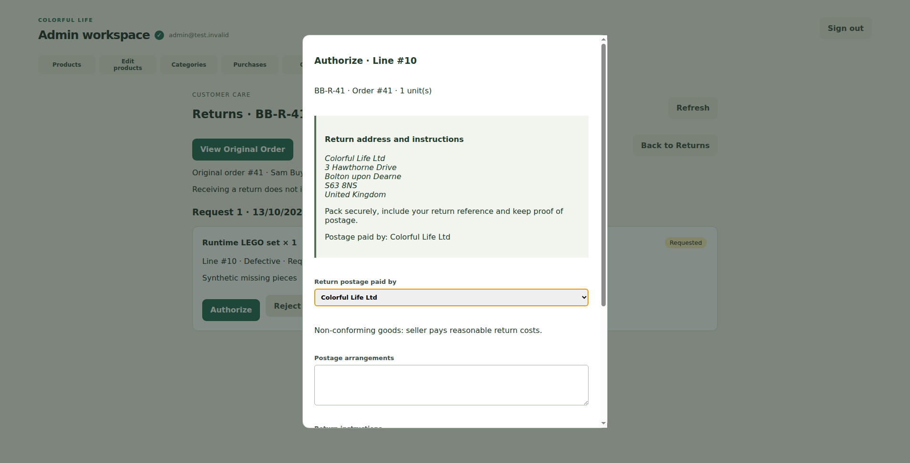
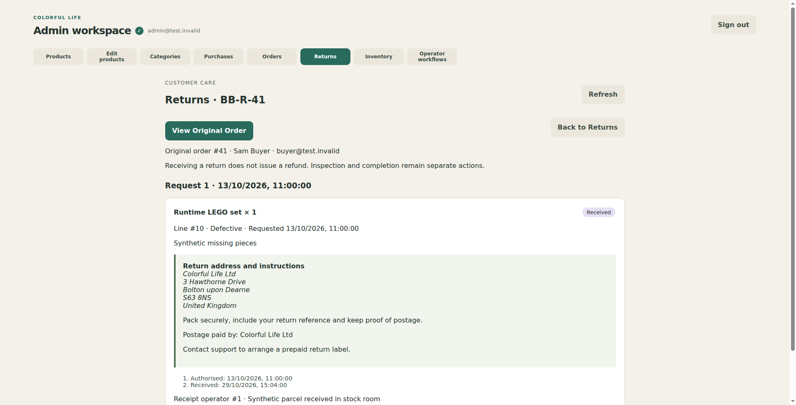
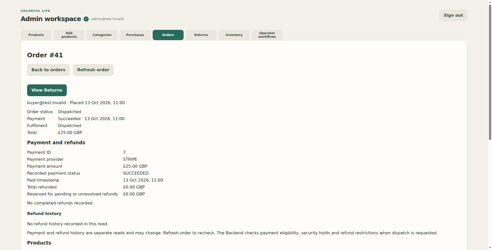

# Returns management V1

## Confirmed eligibility policy

Owner confirmed: Return Management begins only after confirmed dispatch on a paid order. Before dispatch, paid orders use the existing cancellation/refund/support process; unpaid orders never initiate payment refunds. Admission is enforced by Backend as well as UI. The missing selected-item/quantity pre-dispatch refund workflow is documented as a separate gap in Backend `docs/pre-dispatch-item-refund-gap.md`; this PR does not add it.

Draft implementation; no merge/deployment approval is implied.

The dedicated Returns section supports a paginated status queue, customer/original-order context, permanent return references, separately dated submissions and independent line decisions. Authorisation previews the owner-approved return address and actual postage arrangements. Fault/non-conformity acceptance assigns seller postage; cancellation rights and pre-sale disclosure need explicit review. Rejection requires a factual customer-visible reason. Receipt records actual date, authenticated operator and notes; inspection/completion remain separate and never initiate refunds.

The renderer uses only the typed `adminReturns` preload bridge. Main-process IPC validates IDs, action names and body fields, uses existing authenticated fetch/session renewal, and does not expose tokens, raw URLs or operator-ID overrides. Native caller/CSP/window protections remain active. Error responses are not displayed as empty successful queues.

## Navigation

Every case has a prominent **View Original Order**, which opens the existing order detail directly. Every original order has **View Returns**, opening that order's same permanent case. Return filter/page are held at workspace level, so opening the original order and returning preserves queue context. No manual ID entry is needed. Queue filter uses the line status, so a case can appear in more than one status queue while different lines progress independently.

## Review evidence

- Unit/UI tests cover direct navigation both ways, retained filter, confirmation/preview, receipt without refunds, session blocking, main-process validation and IPC allowlisting.
- `test:orders-runtime` exercises compiled Main/preload/production renderer with synthetic HTTP fixtures: queue/detail, original order round-trip, original filter, native authorisation dialog and receipt. It asserts exactly two mutation calls, both to return endpoints, and captures screenshots.
- Existing purchase, order, inventory, packaged security and development security journeys remain required. Electron boundary verification explicitly allows only three additional Returns channels; security journeys exercise all 63 handlers against spoofed callers.
- Shared return DTO is checked byte-for-byte against the same immutable Backend source as the existing integration contract.

Synthetic screenshots:

## Release dependencies and acceptance

Backend return migration/grants and endpoints must release first under separate owner approval. Keep this PR Draft until Claude Opus reviews the exact head. Do not send return calls to an old backend. Account instructions and authorisation email delivery are implemented by Backend's existing durable outbox/SES channel, not Electron.

- [ ] Select a pending line, inspect original order, return to the same case/filter.
- [ ] Review rights, address and actual postage; confirm authorisation once.
- [ ] Reject another line with a legitimate reason, leaving the first line unchanged.
- [ ] Confirm receipt with date/note/operator; verify no refund is initiated.
- [ ] Inspect and complete only when eligible; validate approved restock quantity and existing used-offer restrictions.
- [ ] Check notification state and investigate blocked/unknown delivery without blind resend.
- [ ] Retry a stale/conflicting action only after reading current server state.

No payment-provider behaviour, production records, infrastructure or live configuration was changed.

## Independent-review correction

Claude Opus's initial read-only review requested that failed return actions announce their error inside the active native modal (outside content is inert while `showModal()` is active). The error is now passed into the decision form, with a regression asserting the alert within the open dialog. Full Admin verification passes with 541 unit/UI tests plus native runtime/security journeys. Final-head independent re-review is required before leaving Draft.

The second Opus review identified obsolete return actions in Operator workflows. Those six specs are now retired from the active menu and execution path; return actions use the dedicated workspace. Their descriptors remain solely for validating and showing old saved intents, which are preserved for investigation rather than discarded or blindly retried. A retained intent links directly to its return case. Regression tests verify no retired endpoint is sent and no saved evidence is changed. Non-return operations and financial intent handling are unchanged.
